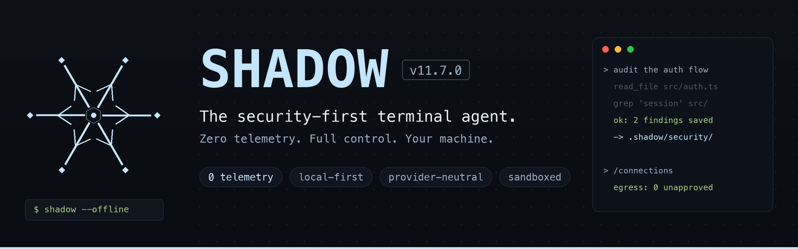

<p align="center">
  
</p>

<p align="center">
  <a href="https://github.com/Blackfrost-AI/Shadow_CLI/releases"></a>
  
  
  
  <a href="LICENSE"></a>
</p>

# Shadow CLI

Current build: **`v11.7.0`** — TUI immersion: clickable OSC 8 links, a configurable prose width (`proseMaxCols`), a grouped drill-in command menu (`/menu`) with a repository file browser (`/repo`), named model roles (`/role`), and Ctrl+P model cycling (`--models`). Restores the Snowfall image viewer fallback.

Shadow is a local-first, provider-neutral security engineering agent. Its built-in Security
foundation covers investigation, hardening, incident response, defensive automation, secure coding,
and the systems work those tasks require. It connects a model you choose to tools that read, edit,
search, and run commands in your workspace. Permissions, budgets, session history, and connection
receipts stay under your control. Shadow requires no Shadow account and includes no telemetry service.

**Built for security professionals who want zero telemetry and full control.** Every model call goes
to the endpoint *you* configure; every network request is brokered, receipted, and can be switched
off entirely with `--offline`. Nothing phones home.

## What's new in v11.7.0

- **Repository browser & grouped menu** — `/menu` drills into grouped command categories; `/repo`
  browses the workspace with a live busy-guard before opening the editor.
- **Model roles & cycling** — assign `smol`/`slow`/`plan` roles via `/role` (`config.roles`), and
  cycle an allowlist with `Ctrl+P` (`--models`).
- **Clickable links** — OSC 8 hyperlinks open in your browser behind the `linkClickOpen` gate.
- **Readable prose** — `proseMaxCols` (default 100, `0` = fill) keeps long answers readable and the
  layout reflows cleanly when you resize the terminal.
- **Image save/open fallback** — Snowfall saves an image and opens it with your system viewer when
  inline rendering isn't available.

Recent releases also landed **information survival** (completed background tasks wake idle sessions;
compaction spills cleared tool output to recoverable locators), **live memory** (facts refresh
mid-session without busting the prompt cache), and **injection-safe compaction** (untrusted tool
output stays enveloped through summarization). See the [changelog](CHANGELOG.md) for the full history.

## The terminal

Snowfall is the default terminal: a full-screen conversation with search, prompt navigation, a
compact session footer, and a pinned composer. Start this checkout with `npm start` after building.
Use `/theme snowfall` for the ice palette; saved themes remain active. `SHADOW_TUI=ink npm start`
retains the compatibility renderer. The [terminal contract](docs/TERMINAL_RENDERERS.md) lists
commands, keys, and migration decisions.

Shadow names conversations from their opening prompt and shows the active name in the terminal
title. Find names through `/resume`, or use `/rename Website launch` to choose one. `/new` keeps the
previous named conversation available to resume.

## What Shadow does

- Runs coding tasks interactively in the terminal or through `--task`.
- Connects to ChatGPT/Claude subscriptions, API providers, and self-hosted model endpoints.
- Supports workspace edits, shell commands, tool approvals, plan mode, and bounded agent runs.
- Keeps sessions, checkpoints, memory, and context compaction for ongoing work.
- Loads trusted local harness add-ons for new sessions without choosing or restricting your endpoint.
- Uses `/learn` to prepare evidence-linked local skill candidates for explicit operator review and activation.
- Extends the runtime with MCP servers, skills, and data-only plugins.
- Offers a local web companion through `shadow web` and an ACP editor bridge through `shadow acp`.
- Provides live `/work`, durable `/jobs`, retained worktree artifacts, scoped `/review`,
  profile-based `/consult`, and bounded `/team` workflows — see the
  [collaboration guide](docs/COLLABORATION.md).

## Install

The public installers download standalone binaries and verify their signed checksums (ECDSA P-256,
pinned public key) before anything is placed on your PATH.

Shadow's website and installers are at [blackfrostai.com/shadow](https://blackfrostai.com/shadow).
The latest signed binary release is [v11.1.0](https://github.com/Blackfrost-AI/Shadow_CLI/releases/tag/v11.1.0);
newer tags are source-only. Existing standalone installations can upgrade with `shadow update`.

macOS / Linux:

```sh
curl -fsSL https://blackfrostai.com/shadow/install.sh | sh
```

Windows PowerShell:

```powershell
irm https://blackfrostai.com/shadow/install.ps1 | iex
```

For development or a source installation, use Node **22.19.0 or newer** and npm:

```sh
npm ci
npm run build
node dist/index.js --help
```

Standalone-binary development uses Bun **1.4.2**: `npm run build:binary`. Set `BUN` to a
compatible executable if it is not on your PATH. Run tests with Node (`npm test`), never Bun.

## Start a session

```sh
shadow onboard
shadow
```

`shadow onboard` opens local browser setup: connect an endpoint, discover and select models, then
verify and save into the encrypted vault. First-run interactive sessions open the same flow. Use
`shadow onboard --terminal` (also `--cli`) for terminal-only setup, including **Subscription account**
for ChatGPT / official Claude Code sign-in and **Local file** for GGUF / MLX. `shadow onboard --no-open`
prints a local URL without launching a browser; on SSH, forward its loopback port. Subscription setup
runs in the terminal. Subscription connections keep their selected account and never automatically
fall back to API billing. Environment variables and CLI flags can override other saved configuration;
the [user guide](docs/USER_GUIDE.md) explains the available settings and credential paths.

```sh
shadow --task "Explain the code in this workspace"
shadow web
shadow doctor
shadow doctor --privacy
```

To exercise the source checkout without a model endpoint:

```sh
node dist/index.js --provider mock --model mock-1 --task "Hello"
```

## Permissions and privacy

The default autonomy level is `auto-edit`. Use `--autonomy manual` for explicit tool approvals.
`--autonomy full` grants broader filesystem and shell access; `--yolo` also waives the destructive
command denylist. Choose these modes with their actual authority in mind.

Provider requests send conversation data and authentication to your configured endpoint. Optional
web tools, MCP servers, plugin operations, and updates have their own network behavior. Use
`shadow doctor --privacy`, `shadow egress`, and `--offline` to inspect or restrict it.
Claude subscription requests run through your installed official Claude Code engine, which owns
its credentials and network connections. Shadow disables its nonessential traffic; those child-process
sockets are outside Shadow's fetch receipt. See the [subscription guide](docs/USER_GUIDE.md#subscription-accounts).

The [threat model](docs/security/THREAT_MODEL.md) describes the workspace jail, sandbox, approvals,
credential storage, egress policy, and their limits. OS sandbox support differs by platform.

## Documentation

- [User guide](docs/USER_GUIDE.md): workflows, configuration, keys, and commands.
- [Terminal renderers](docs/TERMINAL_RENDERERS.md): Snowfall layout, command/key matrix, and Ink migration paths.
- [Self-hosting](docs/SELF_HOSTING.md): local endpoints and the web companion.
- [Model compatibility](docs/COMPAT_MATRIX.md): recorded provider and model checks.
- [Collaboration](docs/COLLABORATION.md): bounded multi-agent work.
- [Threat model](docs/security/THREAT_MODEL.md): trust boundaries and defenses.
- [Vision](docs/VISION.md): connect a vision endpoint.
- [Testing](docs/TESTING.md): test runner and verification details.
- [Documentation index](docs/README.md): current guides and security material.
- [Changelog](CHANGELOG.md): release history.

## Development

```sh
npm run typecheck
npm run typecheck:all
npm run lint
npm test
npm run build
npm run check:release-gate
```

Run tests with `npm test`. The suite relies on Node honoring its isolated test homes; running
`bun test` can operate on real credential files. Bun is used separately to compile standalone
binaries with `npm run build:binary`.

## License

[MIT](LICENSE).